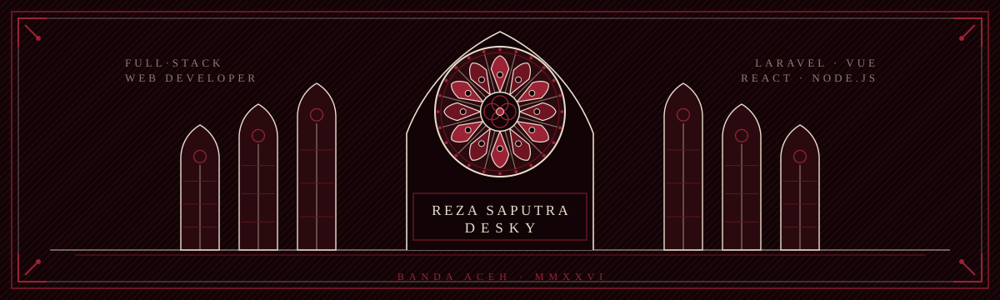

  

  
  
  
  

Full-stack web developer dari **Banda Aceh**. Saya membangun aplikasi web end-to-end, mobile lintas platform, dan REST API, dari skema database sampai antarmuka yang dipakai orang.

- **Fokus:** web app, aplikasi mobile, REST API, integrasi cloud
- **Stack utama:** PHP / Laravel, TypeScript, Vue, React, Node.js, SQL
- **Status:** terbuka untuk kontrak, konsultasi teknis, dan kolaborasi

| Project | Stack | Deskripsi |
| :--- | :--- | :--- |
| **[IDEOSTORE](https://github.com/rezadesky/IDEOSTORE)** | Laravel, Inertia, Vue | Toko produk digital otomatis dengan katalog live dan checkout QRIS |
| **[RSDVault](https://github.com/rezadesky/RSDVault)** | React Native, Expo, SQLite | Aplikasi keuangan pribadi offline-first |
| **[YABAT-Presensi](https://github.com/rezadesky/YABAT-Presensi)** | Laravel, React Native | Presensi pegawai berbasis geofencing |
| **[Absensi-STKIPUS](https://github.com/rezadesky/Absensi-STKIPUS)** | Laravel, MySQL | Sistem absensi mahasiswa dan staf kampus |
| **[PDF-Tool](https://github.com/rezadesky/PDF-Tool)** | Next.js, TypeScript | Merge dan split PDF langsung di browser, tanpa upload |
| **[Portfolio](https://github.com/rezadesky/Portfolio)** | React, Vite, Tailwind | Situs portfolio — [rezasaputradesky.work](https://rezasaputradesky.work) |

  

  
  

